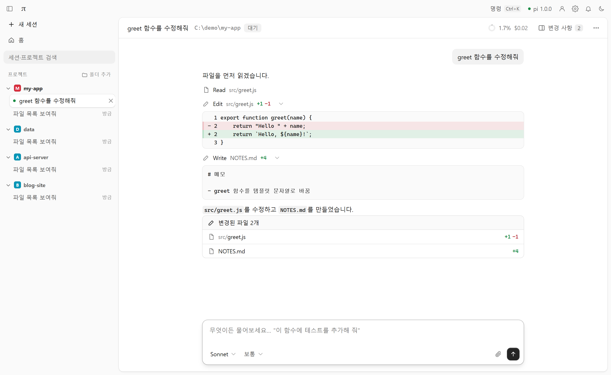
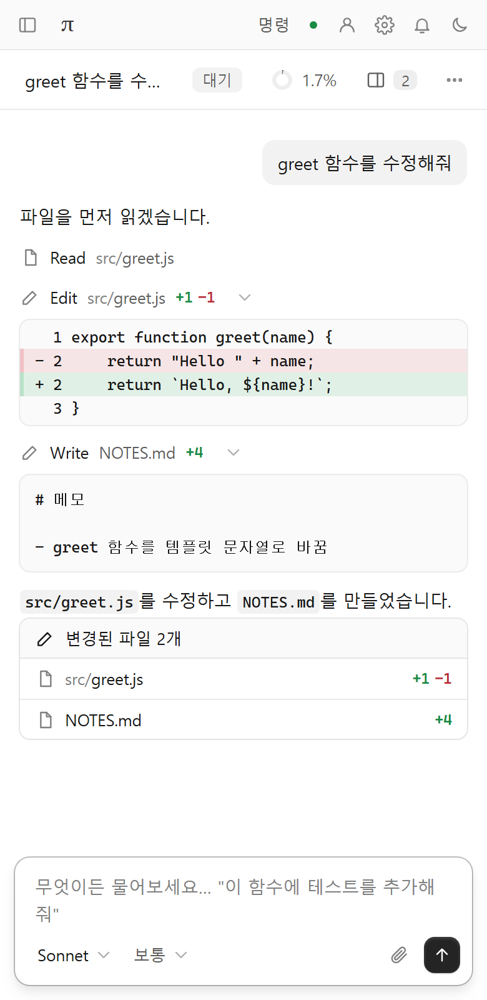

<div align="center">

# pi-web

**[pi](https://github.com/earendil-works/pi) 코딩 에이전트를 위한 브라우저 GUI**

의존성 0개 · 설치 프로그램 없음 · 데스크톱과 스마트폰 모두 지원

한국어 · [English](README.en.md) · [简体中文](README.zh-CN.md)

</div>

<p align="center">
  <picture>
    <source media="(prefers-color-scheme: dark)" srcset="docs/images/session-dark.png">
    
  </picture>
  &nbsp;
  
</p>

<p align="center"><sub>샘플 데이터로 만든 화면입니다. 화면 언어는 한국어입니다.</sub></p>

## 개요

pi-web은 세션마다 `pi --mode rpc` 프로세스를 실행하고, 브라우저와는 HTTP와 SSE로 통신하는 작은 게이트웨이 서버입니다. 터미널 pi의 세션 파일(`~/.pi/agent/sessions`)을 그대로 사용하므로 터미널에서 시작한 대화를 웹에서 이어 가거나 그 반대로 쓸 수 있습니다.

## 주요 기능

- **프로젝트 사이드바**: 모든 프로젝트와 세션을 폴더별로 한곳에서 관리합니다. 실행 중인 세션의 상태(작업 중·응답 대기)가 표시되고, 저장된 세션은 클릭해서 바로 이어 갑니다.
- **턴 단위 대화 화면**: 탐색(파일 읽기·검색)은 한 줄로 접히고, 셸·편집·쓰기는 출력과 diff를 바로 보여 줍니다. 턴이 끝나면 변경된 파일 목록과 토큰·비용이 표시됩니다.
- **변경 사항 패널**: 세션에서 바뀐 파일 전체의 diff를 한눈에 확인합니다.
- **파일·이미지 첨부**: 끌어다 놓기, 붙여넣기, 클립 버튼을 지원합니다.
- **계정·설정·업데이트**: 구독(OAuth) 또는 API 키 로그인, 자주 쓰는 pi 설정, pi 버전 확인과 업데이트를 화면 안에서 처리합니다.
- **명령 팔레트** (`Ctrl+K`), `/` 명령과 `@` 파일 자동완성, `!` 셸 실행, 다크 모드, 작업 완료 알림.
- **어디서나 사용**: 반응형 화면, 앱으로 설치(PWA), 원격 접속(Tailscale), 로그온 시 자동 시작.

## 요구 사항

- Node.js 22.19 이상
- [pi](https://github.com/earendil-works/pi) 설치와 로그인 (터미널에서 `pi`를 실행해 `/login`)
- 운영체제: Windows에서 개발하고 검증했습니다. 서버(`node server.mjs`)는 macOS·Linux에서도 동작하도록 작성했지만 아직 검증하지 못했습니다. `start.cmd`, `piweb` 등 보조 스크립트는 Windows 전용입니다.

## 빠른 시작

1. Node.js와 pi를 설치합니다. `node -v`가 `v22.19` 이상이어야 합니다.
2. 저장소를 내려받습니다. **Code → Download ZIP**으로 받아 원하는 위치에 풀거나, 다음 명령을 사용합니다.
   ```bash
   git clone https://github.com/guineapig987/pi-web-gui.git
   cd pi-web-gui
   ```
3. 실행합니다. 폴더는 어디에 두어도 되고 `npm install`도 필요 없습니다.
   - Windows: `start.cmd`를 더블클릭
   - 그 밖: `node server.mjs --open`
4. 브라우저에서 <http://127.0.0.1:8787>이 열립니다. 종료하려면 실행 창을 닫습니다.

> pi를 찾지 못하면 아래 환경 변수 `PI_CLI`로 경로를 지정하세요.

## 사용법

### 화면 구성

| 영역 | 설명 |
|---|---|
| 사이드바 | 프로젝트별 실행 중·저장된 세션. 프로젝트 줄의 `+`로 그 폴더에서 새 세션 시작, `폴더 추가`로 프로젝트 추가, 검색창으로 전체 세션 검색. `Ctrl+B`로 접고 펼칩니다. |
| 홈 | 프로젝트 목록과 세션 목록(오늘·이번 주·이번 달로 그룹화). |
| 대화 | 내 메시지, 에이전트의 작업(탐색·편집·셸), 변경된 파일, 모델·소요 시간·토큰·비용. |
| 변경 사항 패널 | 세션 전체의 파일별 diff. 폭 조절 가능. |
| 입력창 | 모델·생각 수준 선택, 첨부, 전송·중지. 확장의 확인·선택 요청은 입력창 위에 카드로 나타납니다. |

### 단축키

| 키 | 동작 |
|---|---|
| `Ctrl+K` | 명령 팔레트 (명령과 모든 프로젝트의 세션 검색) |
| `Ctrl+Shift+S` | 새 세션 |
| `Ctrl+B` | 사이드바 접기·펼치기 |
| `Ctrl+L` | 입력창으로 이동 |
| `Ctrl+Shift+E` | 변경 사항 패널 |
| `Alt+0` / `Alt+1…9` | 홈 / 사이드바 순서대로 세션 전환 |
| `Enter` / `Shift+Enter` | 보내기 / 줄바꿈 |
| 작업 중 `Enter` / `Ctrl+Enter` | 끼어들기(조향) / 끝난 뒤 보내기 |
| `Esc` | 작업 중지 |

### 파일 첨부

이미지는 모델에 그대로 전달됩니다. 그 밖의 파일(문서·코드·압축 파일 등)은 서버 PC의 `~/.pi/agent/web-uploads/`에 저장되고, 경로가 프롬프트에 포함되어 pi가 도구로 읽습니다. 한 파일의 최대 크기는 100MB(`PI_WEB_MAX_UPLOAD_MB`)이며, 업로드한 파일은 자동으로 삭제되지 않습니다. 텍스트·코드처럼 pi가 읽을 수 있는 형식이 가장 잘 동작합니다.

### 로그인과 설정

- **계정·로그인**: 공급자를 선택해 구독 계정(OAuth)으로 로그인하거나 API 키를 저장합니다. 터미널 pi의 `/login`과 같은 코드를 서버가 실행합니다. 키와 토큰은 브라우저에서 서버로만 전달되며 화면·로그에 다시 나오지 않습니다.
- **설정**: pi의 전역 `settings.json` 중 자주 쓰는 항목(생각 수준, 자동 압축, 자동 재시도, 프록시 등)을 바꿉니다. 목록에 없는 항목과 프로젝트의 `.pi/settings.json`은 건드리지 않습니다.

### pi 업데이트

시작할 때와 6시간마다 설치된 pi와 최신 버전(pi.dev)을 비교합니다. 새 버전이 있으면 상단에 알림이 나타나고, 버튼 또는 `/update`로 현재·최신 버전과 변경 내역을 확인한 뒤 **지금 업데이트**로 `pi update`를 실행합니다. 작업 중인 세션이 있으면 시작하지 않으며, 끝난 뒤 대기 중인 세션은 자동으로 다시 시작되어 새 버전을 사용합니다. pi를 npm이 아닌 방법으로 설치했다면 그 방법으로 업데이트하세요.

## 설정

### 실행 옵션

| 옵션 | 설명 |
|---|---|
| `--port <번호>` | 포트 (기본 `8787`, 환경 변수 `PI_WEB_PORT`) |
| `--cwd <폴더>` | 처음 열 프로젝트 폴더 (기본: `~/Documents/pi`) |
| `--host <주소>` | 바인딩 주소 (기본 `127.0.0.1`, 환경 변수 `PI_WEB_HOST`) |
| `--remote` | 다른 기기의 접속 허용: 모든 네트워크 카드에서 수신. **로그인이 없습니다.** [원격 접속](#원격-접속) 참고 |
| `--open` | 시작하면서 브라우저 열기 |

### 환경 변수

| 변수 | 설명 |
|---|---|
| `PI_CLI` | pi의 `cli.js` 또는 실행 파일 경로 (자동 탐색 실패 시) |
| `PI_WEB_DEFAULT_DIR` | 새 세션의 기본 작업 폴더 (기본 `~/Documents/pi`, 없으면 생성) |
| `PI_WEB_PI_PACKAGE` | pi 패키지(`@earendil-works/pi-coding-agent`) 폴더. 로그인 기능이 라이브러리를 못 찾을 때 |
| `PI_WEB_PI_ARGS` | pi에 추가로 넘길 인자 (예: `--approve`) |
| `PI_WEB_ALLOWED_HOSTS` | 허용할 Host 헤더 목록(쉼표 구분). 도메인·프록시로 접속할 때 |
| `PI_WEB_MAX_UPLOAD_MB` | 첨부 파일 한 개의 최대 크기 (기본 100) |
| `PI_WEB_IDLE_MINUTES` | 아무도 보지 않는 대기 세션을 종료하기까지의 시간 (기본 30분) |
| `PI_WEB_NO_UPDATE_CHECK` | `1`이면 최신 버전을 확인하지 않음 (`PI_OFFLINE`도 동일) |

PowerShell 예시:

```powershell
$env:PI_CLI = "$env:APPDATA\npm\node_modules\@earendil-works\pi-coding-agent\dist\bundle\cli.js"
node server.mjs --open
```

## 원격 접속

pi는 서버 PC의 파일을 읽고 쓰며 명령을 실행할 수 있습니다. **이 서버에는 로그인 기능이 없으므로 인터넷에 직접 노출하면 안 됩니다.** 공유기 포트를 여는 대신, 내 기기끼리만 연결되는 무료 개인용 VPN인 [Tailscale](https://tailscale.com)을 권장합니다.

1. 서버 PC와 접속할 기기(스마트폰 등)에 Tailscale을 설치하고 **같은 계정**으로 로그인합니다.
2. 서버 PC에서 원격 모드로 실행합니다.
   ```bash
   npm run start:remote        # = node server.mjs --remote
   ```
3. 시작 화면에 나오는 `Tailscale: http://100.x.y.z:8787` 주소를 다른 기기의 브라우저에서 엽니다. Windows 방화벽 창이 뜨면 "개인 네트워크"에서 허용하세요.
4. HTTPS 주소(`https://<PC이름>.<tailnet>.ts.net`)가 필요하면 서버 PC에서 `tailscale serve --bg 8787`을 실행합니다.

**보안 주의**

- Tailscale에 로그인된 내 기기는 모두 이 서버를 쓸 수 있습니다. Tailscale 계정에 2단계 인증을 켜세요.
- 카페 같은 공용 네트워크에서 `--remote`나 `--host 0.0.0.0`을 켜면 같은 네트워크의 누구나 접속할 수 있습니다.
- 원격 모드에서는 서버 PC 화면에 뜨는 폴더 선택 창과 로그인용 터미널 창이 비활성화됩니다. 폴더는 화면의 목록에서 고르세요.
- 서버 PC가 꺼지거나 절전 상태가 되면 접속할 수 없습니다.

### 앱으로 설치 (PWA)

Chrome·Edge의 주소창 설치 아이콘(또는 메뉴 → 앱으로 설치)으로 독립 창 앱이 됩니다. 브라우저 규칙상 `localhost` 또는 HTTPS 주소에서만 설치할 수 있으므로, 원격에서 설치하려면 위의 `tailscale serve` 주소를 사용하세요.

### 항상 켜 두기 (Windows)

창 없이 백그라운드로 실행하고 로그온할 때 자동으로 시작되게 할 수 있습니다. 프로젝트 폴더에서 `piweb`(PowerShell에서는 `.\piweb`)을 입력하면 명령 목록과 현재 상태가 나옵니다. `piweb setup`을 한 번 실행하고 터미널을 새로 열면 어느 폴더에서든 `piweb`을 쓸 수 있습니다(`piweb unsetup`으로 해제).

| 명령 | 동작 |
|---|---|
| `piweb install` | 로그온 시 자동 시작 등록(작업 스케줄러 `pi-web`) 후 시작. 원격 모드로 실행됩니다. |
| `piweb uninstall` | 자동 시작 해제 후 중지 |
| `piweb status` / `open` / `log` | 상태와 접속 주소 / 브라우저 열기 / 최근 로그 |
| `piweb start` / `stop` / `restart` | 시작 / 중지 / 다시 시작 (코드를 고친 뒤) |

로그는 `logs/`에 저장됩니다. 프로젝트 폴더를 옮겼다면 `piweb install`을 다시 실행하세요. PowerShell 실행 정책과 상관없이 `piweb.cmd`가 스크립트를 호출합니다.

## 알려진 제한

- pi의 터미널 전용 UI(`ctx.ui.custom()` 등)와 `/tree` 같은 TUI 내장 명령은 RPC 모드에서 동작하지 않습니다.
- 같은 세션을 터미널 pi와 웹에서 **동시에** 열면 세션 파일이 손상될 수 있습니다. 한쪽을 닫고 여세요.
- 프로젝트의 `.pi/` 확장·설정은 저장된 신뢰 결정이 있을 때만 로드됩니다(터미널 pi에서 `/trust`, 또는 `PI_WEB_PI_ARGS=--approve`).
- 사이드바는 세션 파일 전체를 읽어 목록을 만들기 때문에, 세션이 수천 개로 늘면 갱신이 느려질 수 있습니다.

## 프로젝트 구조

```
server.mjs                  HTTP 서버, API 라우팅, SSE
lib/pi-launcher.mjs         pi 실행 경로 탐색 (Windows .cmd 래퍼 → 실제 cli.js)
lib/pi-process.mjs          pi RPC 프로세스 (JSONL 프레이밍, 요청·응답 매칭)
lib/live-session.mjs        실행 중인 세션, 이벤트 버퍼, 재연결 시 재전송
lib/session-store.mjs       세션 파일 목록
lib/auth-service.mjs        로그인·로그아웃 (pi ModelRuntime)
lib/settings-service.mjs    settings.json 읽기·쓰기
lib/uploads.mjs             첨부 파일 업로드
lib/pi-update.mjs           pi 버전 확인과 `pi update`
lib/native-picker.mjs       OS 폴더 선택 창
lib/files.mjs               @ 파일 검색, 폴더 선택기, 새 폴더 생성
public/js/reducer.js        pi 이벤트 → 화면 상태 (서버와 브라우저 공용)
public/js/*.js              화면 (대화, 도구 카드, 입력창, 모달)
start.cmd, piweb.cmd, pi-web-service.ps1   Windows 실행·백그라운드 관리
test/                       테스트 (가짜 pi, 진짜 pi, 브라우저)
```

## 테스트

기본은 진짜 pi로 확인하며, 가짜 pi(`test/fake-pi.mjs`)는 모델 호출 없이 정해진 이벤트를 재현해야 하는 자동 테스트에만 사용합니다.

```bash
node test/unit.mjs                # 순수 로직 (리듀서, 마크다운, 버전·첨부 처리)
node test/server-auth.mjs         # 서버 API: 로그인·설정·업데이트·업로드 (가짜 pi)
node test/real-pi.mjs             # 진짜 pi 점검(무료): 버전·로그인 상태·세션 시작·모델 목록·업로드
node test/real-pi.mjs --prompt    # + 모델에 짧은 질문 2개 (로그인한 계정의 토큰을 조금 사용)
node test/real-server.mjs         # 진짜 pi로 화면 직접 확인 (http://127.0.0.1:8791)
node test/e2e.mjs                 # 브라우저 자동 테스트 (가짜 pi, Playwright 필요)
```

진짜 pi 테스트는 내 로그인(`~/.pi/agent`)을 쓰되 대화 기록은 임시 폴더에 만들고 끝나면 지웁니다. 요금제 한도·로그인 만료 같은 계정 문제로 모델을 호출할 수 없으면 실패가 아니라 "건너뜀"으로 표시합니다. `npm test`는 가짜 pi 기반 테스트만 실행합니다.

## 라이선스

[MIT](LICENSE)
